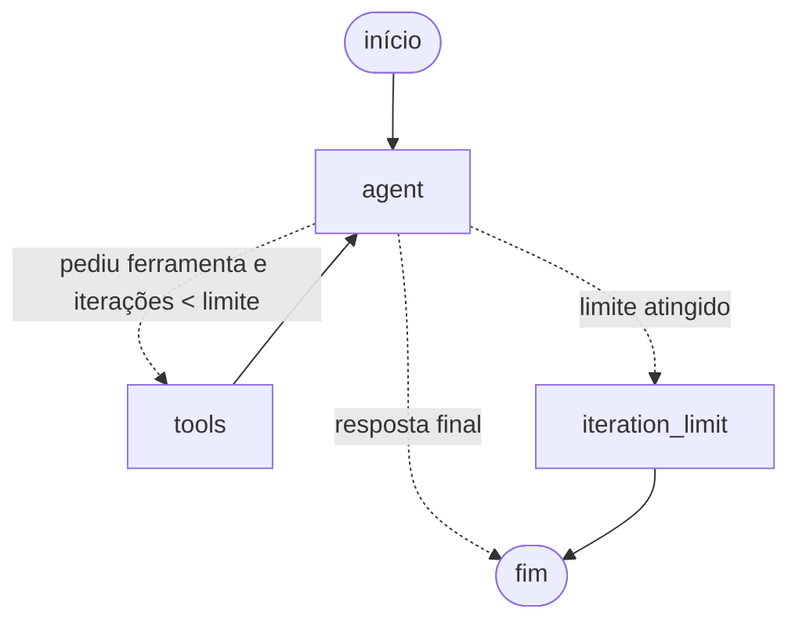

# Arquitetura do Atlas AI

## Visão geral

```
Cliente HTTP
    │  POST /chat {"message": "..."}
    ▼
┌──────────────────────────── app/api ────────────────────────────┐
│ schemas.py   → valida entrada/saída (Pydantic)                  │
│ routes.py    → /chat, /chat/stream (SSE), /threads, UI web      │
│ dependencies.py → monta o AgentService (injeção de dependência) │
└──────────────────────────────┬──────────────────────────────────┘
                               ▼
┌─────────────────────────── app/agent ───────────────────────────┐
│ service.py → executa o grafo (completo ou em streaming)         │
│ graph.py   → StateGraph do LangGraph (loop ReAct)               │
│ prompts.py → system prompt                                      │
└───────────────┬─────────────────────────────────┬───────────────┘
                ▼                                 ▼
      app/llm.py (Gemini)               app/tools/ (ferramentas)
```

`app/static/index.html` é a interface web (HTML, CSS e JS puros).
`app/memory.py` cuida da memória persistente e `app/security.py` dos controles de segurança.
`app/config.py` centraliza as configurações (lidas de variáveis de ambiente).
`app/main.py` cria a aplicação FastAPI e registra os tratadores de erro.

## O loop do agente



1. **agent**: o Gemini recebe o system prompt + histórico e decide se responde
   ou se pede uma ou mais ferramentas (*tool calling*). O contador `iterations`
   é incrementado.
2. **tools**: o `ToolNode` do LangGraph executa as ferramentas pedidas e adiciona
   o resultado como `ToolMessage` (a "observação").
3. O ciclo volta para **agent**, que agora enxerga o resultado.
4. Se o modelo ainda quiser ferramentas ao atingir `AGENT_MAX_ITERATIONS`, o nó
   **iteration_limit** encerra com uma mensagem explicativa.

## Decisões técnicas

| Decisão | Motivo |
| --- | --- |
| `StateGraph` explícito em vez de um agente pronto | Mostra cada etapa do loop e permite um limite de iterações com mensagem amigável. É a base para evoluções (memória, aprovação humana, streaming). |
| Agente único, sem multiagente | O MVP não precisa de coordenação entre agentes; menos peças, mais fácil de testar e explicar. |
| Modelo injetado em `build_agent_graph` | Permite trocar o Gemini por um modelo falso nos testes (sem rede e sem chave) ou por outro provedor no futuro. |
| Limite em duas camadas | O contador de iterações é o limite "de negócio"; o `recursion_limit` do LangGraph é a rede de segurança caso algo saia do previsto. |
| Ferramentas retornam `"Erro: ..."` em vez de lançar exceção | Erros esperados (divisão por zero, fuso inválido) viram observações que o modelo explica ao usuário. Erros inesperados são capturados pelo `ToolNode(handle_tool_errors=True)`. |
| Calculadora com AST e lista branca | `eval` executaria código arbitrário. Só números, operadores e funções explicitamente permitidas são aceitos; expoentes e tamanho da expressão são limitados para evitar abuso de CPU/memória. |
| Relatórios em diretório isolado | O modelo fornece apenas título e conteúdo; o nome do arquivo é gerado pelo servidor, o caminho é verificado após `resolve()`, arquivos nunca são sobrescritos (modo `"x"`) e o caminho absoluto não é exposto. |
| `pydantic-settings` + `SecretStr` | Chave apenas em variável de ambiente/`.env`; `SecretStr` evita que ela apareça em logs ou `repr`. |
| Serviço criado sob demanda | A API sobe e o `/health` responde mesmo sem chave; `/chat` devolve 503 com instrução clara. Como o FastAPI resolve dependências antes de validar o corpo, sem chave configurada o 503 aparece antes de um eventual 422. |
| Tratadores de exceção globais | Erros do provedor viram 502, falta de configuração vira 503, qualquer outro erro vira 500 genérico sem vazar detalhes internos. |
| Memória com checkpointer + `thread_id` | O LangGraph salva o estado da conversa a cada passo. O cliente só guarda o `thread_id`; o histórico fica no servidor. |
| SQLite (`AsyncSqliteSaver`) | Persistente, sem servidor de banco para instalar e suficiente para um único processo. O pacote oficial do LangGraph cuida do formato dos checkpoints; trocar por PostgreSQL é mudar uma linha em `open_sqlite_store`. |
| Tabela `threads` separada | O checkpointer não guarda "quando a conversa foi usada". A tabela própria permite (1) aceitar só ids criados pelo servidor e (2) apagar conversas inativas (`CONVERSATION_TTL_HOURS`), na inicialização e a cada hora. |
| Repositório com duas implementações | `ThreadRepository` (Protocol) tem versão SQLite (produção) e em memória (testes). O serviço não sabe qual está usando. |
| `thread_id` gerado pelo servidor | Se o cliente pudesse escolher o id (ex.: `"conversa-1"`), poderia adivinhar o de outra pessoa. Com 128 bits aleatórios e 404 para ids desconhecidos, o id funciona como uma senha da conversa. |
| Token opcional + limite de requisições | Protegem a cota do LLM: sem eles, qualquer pessoa com o endereço do servidor gastaria seus créditos. O token é comparado com `secrets.compare_digest` (tempo constante). O limite usa janela deslizante em memória, com número máximo de clientes rastreados. |
| CSP estrita na interface | JS e CSS em arquivos próprios permitem `script-src 'self'` sem `unsafe-inline`: mesmo se um texto malicioso escapasse, o navegador não executaria scripts injetados. |
| Histórico enviado ao modelo é cortado | `trim_messages` envia só as `MAX_HISTORY_MESSAGES` mais recentes, começando sempre numa pergunta do usuário, para não separar um pedido de ferramenta do seu resultado. Uma validação garante que o limite comporta um turno completo. |
| Limite de iterações reescreve a última mensagem | Quando o limite é atingido, a mensagem que pedia uma ferramenta é substituída (mesmo `id`) pelo aviso. Sem isso, o histórico salvo teria uma chamada sem resposta e o Gemini rejeitaria o turno seguinte. |
| Streaming com SSE nativo do FastAPI | `EventSourceResponse` + `ServerSentEvent`, sem bibliotecas extras. O grafo é executado com `stream_mode=["messages", "updates"]`: tokens do modelo e resultados das ferramentas. A validação roda numa dependência, antes de o streaming começar, para ainda ser possível devolver 422/503. |
| Interface sem framework | `index.html` + `app.js` + `app.css` servidos pela API. `fetch` + leitura do stream (o `EventSource` do navegador não suporta POST). O texto é inserido com `textContent`, nunca `innerHTML`, para evitar XSS. |

## Códigos HTTP do `POST /chat`

| Código | Quando |
| --- | --- |
| 200 | Resposta gerada (inclusive quando o limite de iterações é atingido). |
| 401 | `ATLAS_API_TOKEN` definido e token ausente ou incorreto. |
| 404 | `thread_id` desconhecido, expirado ou apagado. |
| 413 | Corpo maior que `MAX_REQUEST_BYTES`. |
| 422 | Corpo inválido: mensagem ausente, vazia, só espaços, tipo errado, campo extra ou acima de `MAX_MESSAGE_LENGTH`. |
| 502 | Falha ao consultar o Gemini (rede, cota, chave inválida) ou resposta vazia do modelo. |
| 429 | Limite de requisições atingido (veja o cabeçalho `Retry-After`). |
| 503 | `GEMINI_API_KEY` não configurada. |
| 500 | Erro inesperado (detalhes apenas no log). |

No `POST /chat/stream`, 401, 404, 413, 422, 429 e 503 funcionam igual (são verificados antes do stream).
Falhas durante a execução chegam como evento `error`, porque o status 200 já foi enviado.

## Limitações conhecidas

- **Um único processo**: o SQLite e o limite de requisições em memória funcionam para
  um processo do servidor. Para vários processos/máquinas: PostgreSQL + Redis.
- **Token único, sem contas de usuário**: quem tem o token e um `thread_id` pode
  continuar ou apagar aquela conversa. O próximo passo seria ligar cada conversa a um dono.
- **O token na interface** fica no `sessionStorage` da aba; use sempre HTTPS em produção.
- **Requisições simultâneas no mesmo `thread_id`** não são serializadas.

## Estratégia de testes

- **Ferramentas**: testes unitários puros (casos válidos, entradas maliciosas, limites).
- **Agente**: `ScriptedChatModel` (em `tests/fakes.py`) é um `BaseChatModel` que
  devolve respostas roteirizadas, incluindo *tool calls*. Isso testa o grafo real
  (roteamento, execução de ferramentas, limite de iterações) sem chamar a API.
- **Memória**: conversas no mesmo `thread_id` e em threads diferentes, corte do histórico,
  histórico válido após o limite de iterações e exclusão de conversas.
- **Streaming**: ordem dos eventos SSE, evento `error` e validação antes do stream.
- **Persistência**: o banco SQLite é fechado e reaberto (simulando um reinício) e o agente
  continua lembrando a conversa; exclusão e expiração de conversas.
- **Segurança**: token (ausente, errado, correto), 429 com `Retry-After`, ids escolhidos
  pelo cliente (422) ou desconhecidos (404), cabeçalhos, CSP e corpo grande demais (413).
- **API**: `TestClient` + `app.dependency_overrides` para injetar o agente falso.
